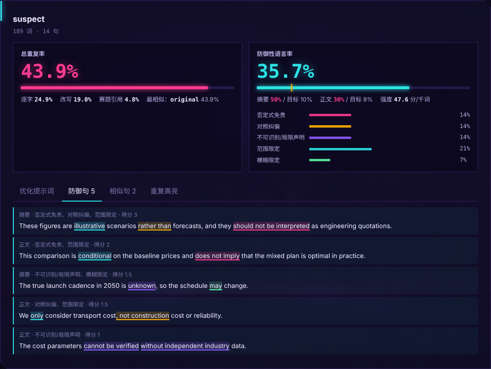

# papersim

数学建模论文的两项自查：**重复率**和**防御性语言率**。查完会为每篇论文生成一份**专项优化提示词**，可以直接交给任意 AI 改稿。

为什么做这个工具：

- **数据要站得住。** 满篇"这不是预测""仅为示意""无法识别"的论文，评委读起来会觉得作者心里没底。
- **区分度要高。** 现在大家都用同一个 AI 写同一道题，不做额外处理，表述和结构就会高度雷同，评委一天看几十篇，雷同段落会被直接略过。

```
论文 PDF ──► 重复率（逐字 + 改写）──┐
          └► 防御性语言率（5 类）──┴──► HTML 报告 + 专项优化提示词 ──► 交给 AI 改稿
```

## 在线使用

**打开 <https://2024-dada.github.io/mathmodeling-paper-checking/> 即可，不用安装。**

- **论文不上传。** PDF 在你的浏览器里解析，所有计算也在浏览器里完成，网站没有服务器端。
- **放文件**：把论文拖进对应区域，或者点击选择。被测论文、比对库、赛题原文各一栏，可以整个文件夹拖进去。拖到页面任意位置会默认加入"被测论文"。
- **填 API（可选）**：粘贴 key 后自动识别服务商，并弹出模型列表，可以搜索，推荐模型会标出来。
  - 先按 key 前缀判断：`sk-ant-` 是 Anthropic，`sk-or-` 是 OpenRouter，`AIza` 是 Gemini，`xxx.yyy` 格式是智谱，UUID 格式是火山方舟。
  - 普通的 `sk-` 开头会同时去问 DeepSeek、OpenAI、Kimi、硅基流动、通义千问，哪家接受就是哪家。
  - 中转或自建网关在"服务商与地址"里填 Base URL；列表拿不到时可以直接输入模型名。
  - key 和句子由浏览器直接发给你选的服务商。勾选"记住 key"时，key 只保存在你自己的浏览器里。
- **选挡位**：防御率分 10 挡，1 挡最硬气（摘要 ≤ 2%），10 挡最保守（摘要 ≤ 30%），默认第 5 挡（摘要 ≤ 10%、正文 ≤ 8%）。挡位决定优化提示词让 AI 删减限定语的力度。
- **余额与消耗**：识别出服务商后自动显示账户余额（DeepSeek、Kimi、硅基流动、OpenRouter 有公开接口；OpenAI、通义、智谱等没有，需到官网控制台查看）。运行时实时统计调用次数和 token 数；查得到余额的服务商用运行前后的余额差算出本次实际花费，也可以填模型单价来估算。
- **看结果**：每篇论文一张卡片，显示重复率、防御率（带目标线）和类别分布；下面分页签显示优化提示词（复制或下载）、AI 修改建议、防御句、相似句、重复高亮。可以下载 HTML 报告、全部提示词、CSV、JSON。

有的服务商不允许网页直接调用，页面会提示"浏览器无法访问"。这时可以换一家服务商、换一个支持跨域的中转地址，或者用下面的本地版。




## 本地版

```bash
git clone https://github.com/2024-dada/mathmodeling-paper-checking.git
cd mathmodeling-paper-checking
pip install -e .
papersim-web            # 自动打开浏览器，默认 http://127.0.0.1:8765
```

界面和在线版完全一样。区别是大模型请求经本机转发，不受浏览器跨域限制，任何服务商都能用。

## 命令行用法

```bash
# 几篇论文互相比对，并扣除赛题原文
papersim 我们的论文.pdf 参考1.pdf 参考2.pdf -x 赛题.pdf -o report.html

# 只测自己的论文，与一个文件夹里的往届/同题论文比对
papersim 我们的论文.pdf -c 往届论文/ -x 赛题.pdf

# 只看防御性语言（单篇即可）
papersim 我们的论文.pdf --only def

# 提示词里附上全文，整段复制给 AI 就能用
papersim 我们的论文.pdf -c 往届论文/ --embed-text

# 指定防御率挡位（1 最硬气 … 10 最保守，默认 5）
papersim 我们的论文.pdf --only def --level 3
```

输出：

- `report.html`：总览、类别分布、重复片段高亮、防御句高亮、提示词（带复制按钮）
- `prompts/<论文名>_优化提示词.md`：每篇一份
- `--csv`、`--json`：汇总和原始数据

### 接入大模型（可选）

支持任何 OpenAI 兼容接口，比如 DeepSeek、通义千问、Kimi、OpenAI、自建网关：

```bash
export PAPERSIM_API_KEY=sk-xxx
export PAPERSIM_BASE_URL=https://api.deepseek.com/v1
export PAPERSIM_MODEL=deepseek-chat
export PAPERSIM_EMBED_MODEL=...      # 可选，设置后改写检测会多用一层语义向量

papersim 论文.pdf -c 往届/ --llm             # 大模型逐句复核防御句，报告里并列"LLM 防御率"
papersim 论文.pdf -c 往届/ --apply           # 直接执行优化提示词，输出 <论文名>_AI修改建议.md
```

## 指标定义

### 重复率

以被测论文的词数为分母，中文按字计。

| 指标 | 含义 |
|---|---|
| 文字复制比 | 与比对库中任一篇连续 n 个词完全相同（英文默认 8 词，中文默认 13 字，可用 `-n` 改） |
| 改写相似比 | 不逐字相同，但句子相似度 ≥ 0.6。相似度取"字符序列相似度"和"实词 Jaccard"两者中较大的，分别对应换词和调语序 |
| **总重复率** | 前两项的并集 |
| 赛题引用比 | 与 `-x` 指定的赛题原文相同的部分，单列，不计入重复率 |

### 防御性语言率

**防御性语言率 = 防御性句数 / 总句数。** 另外分别报告摘要区和正文区的比率，以及防御强度（每千词的总得分）。

一句话按 5 类打分：

| 类别 | 例子 | 权重 |
|---|---|---|
| 否定式免责 | *is not an estimate*、*should not be interpreted as*、并非、不代表 | 1 |
| 对照纠偏 | *rather than*、*A, not B*、*distinguish*、而非 | 1 |
| 不可识别/局限声明 | *cannot be identified*、*unavailable*、*unidentifiable*、无法 | 1 |
| 范围限定 | *only*、*illustrative*、*under the assumption*、仅、在…假设下 | 0.5（*illustrative* 等为 1） |
| 模糊限定 | *may*、*likely*、*approximately*、可能、大致 | 0.5 |

总分 ≥ 1 记为防御性句。强类命中一次就计入；弱类需要两处弱信号同时出现。词典在 [`papersim/lexicon.json`](papersim/lexicon.json)，可以直接改。词典版是**下限估计**，比较隐晦的防御句建议用 `--llm` 复核。

目标按挡位设定（见上文），默认第 5 挡：摘要 ≤ 10%，正文 ≤ 8%。命令行用 `--level` 选挡，也可以用 `--target-summary` 和 `--target-body` 直接指定。

## 优化提示词包含什么

1. **硬约束**：不改任何数字、公式和结论；不编造数据或文献；需要补分析的地方标 `[需补充分析：…]`；保留 AI 使用报告；不做同义替换式的降重。
2. **底气**：每个核心结论按"结论 → 证据 → 稳健性"三步写；不确定性用数字表达；局限集中写一次，每条配应对措施。另附逐句问题清单和分类改写策略。
3. **区分度**：要求写出选择的理由，用本文独有的证据开头，按问题驱动重组结构，给模型命名。另附逐字重复片段、相似句对照、AI 模板腔清单，并要求 AI 先提 3 个差异化切入角度再动笔。
4. **输出格式**：`原句 | 修改后 | 理由` 对照表、改写后的摘要全文、待办清单。

## 示例

```bash
papersim examples/suspect.txt examples/original.txt -x examples/problem.txt -o examples/demo_report.html
```

生成的报告见 `examples/demo_report.html`，提示词在 `examples/prompts/`。

## 局限

- 风格和防御率对 1000 词以下的短文波动较大。
- 同题论文天然会共享数据描述类句子，比如"数据覆盖 34 季"，请结合高亮判断，不要只看数字。
- 本工具用于**自查和改进写作**。竞赛有学术诚信要求，AI 使用必须如实披露。

## 项目结构

| 位置 | 内容 |
|---|---|
| `site/` | 网页前端（GitHub Pages 和本地版共用）。`engine.js` 是检测引擎的 JS 版，算法与 Python 版一致，有测试保证 |
| `papersim/` | Python 包：命令行、检测引擎、本地网页服务 |
| `papersim/lexicon.json` | 防御性语言词典，部署时同步到 `site/` |
| `.github/workflows/pages.yml` | 推送到 main 后自动发布网页 |

## 开发

```bash
pip install -e ".[dev]" && pytest -q      # 有 node 时会同时校验 JS 引擎与 Python 结果一致
```

MIT License

## 网页综合结果区

检测完成后，页面底部集中展示本次参数、余额与消耗、重复率、防御率、风格特征、命中原句和修改建议。各项内容可直接向下阅读，也可以点击论文内的导航定位。

“模板化表达句占比”使用本地中英文特征词典，按命中句数 / 总句数计算，并列出命中词。该比例不等于 AI 生成占比；当前无法推断真实 AI 生成率或 GPT 写作率，对这两项显示“尚不可判定”。CSV、JSON 和 HTML 报告保留指标含义与判定状态。

城市背景沿用参考站 `2024-dada/northern-qi-history` 的 `assets/theme-neon-city-wide.webp`。
检测完成后，可在结果区最底部点击“一键下载 PDF 报告”。PDF 在浏览器内生成并直接下载，包含参数、指标、依据、修改建议和提示词；为兼容中文字体，采用高清页面图像封装，文字不可直接检索复制。
